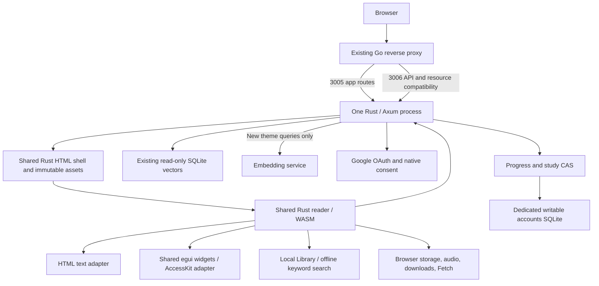

# Cross Cannon Architecture

The website, iOS, and macOS run the same `cross-canon-desktop` Rust app.
The crate name remains stable for existing native build commands.

## Runtime

`r-cross-cannon` is the only server binary. Its primary listener defaults to
3005; optional `R_CROSS_CANNON_COMPAT_BIND` provides the existing edge's 3006
upstream using the same router, state and loaded Library. This preserves current
edge routing without running a second search process. Reader documents, browser
assets, both worker aliases, accounts, native login, compatibility search form
POSTs, commentary metadata, search and text/audio resources all belong to Axum.

The server Library keeps passage identity, filtering metadata and display text
for search, omitting original and per-verse reader strings during loading.
Native and browser artifact loaders retain complete reader text. Server keyword
normalization uses a 16-MiB LRU entry budget; oversized books normalize one
passage at a time. In-flight searches can retain evicted entries, so all blocking
search stages hold the shared four-search permit through completion, including
after a request disconnects. Reader keyword caching keeps its existing policy.

Classics searches and commentary share one lazily initialized metadata catalog
per process. Commentary stores merged verse-coverage ranges after the first
chapter lookup, releasing parsed chapter text. Two separate commentary permits
bound blocking work, with HTTP 429 and Retry-After when busy. Successful catalog
and coverage initialization is cached; transient read failures can retry.

Search CORS and body limits are local to the public search routes. Accounts
retain their own same-origin checks, native bearer handling, private/no-store
responses and larger study request bounds. Browser static gzip/Brotli variants
are prepared off-server and covered by the artifact receipt; audio retains its
existing byte-range behavior. Account and consent documents need no React
runtime. Retained TypeScript helpers live under `scripts/lib/` for explicit import,
indexing, audio and export tasks; no React/Remix server remains.

Google sign-in uses a new opaque browser session and validated OIDC identity.
Existing Better Auth browser sessions require fresh sign-in, as authorized for
this transition; account IDs, stored progress/study and native session hashes
are preserved. Native app handoff still requires browser consent plus private
proof and a one-use return ticket. See [Google login](google-login.md).

## Reader and platform adapters

`rust/desktop/src/text_surface.rs` owns the shared chapter window, passage
events, text projection, and reading snapshot. UIKit (`apple_reader.m`) and HTML
(`web/platform.js`) implement that contract. Native selectable text owns layout,
selection, scrolling, and reading accessibility. Scripture chapter windows follow
the selected Canon across Book boundaries in both directions; Works retain their
own chapter sequence. The focused Passage is the persisted source of truth.
Adapters retain passage anchors through typography changes and chapter prepends,
with verse numbers hidden in the main flow.

The browser Library opens an illustrated reading home and a searchable work
catalog. Its Scripture picker keeps verse buttons below the chapter buttons;
choosing a chapter updates the verses, while Read chapter opens its beginning.
Direct reference lookup also opens a passage. The browser projects book, chapter, and
verse ranges from the offline Rust identity index. Rust validates navigation and
resolves the destination to a Passage. Cover thumbnails use content-addressed
browser assets staged with the offline release. The native Library, search,
account, and study dialogs use shared egui widgets. A narrow
eframe platform-output hook exports clipped AccessKit nodes to UIKit or semantic
HTML buttons/inputs. The HTML adapter maps UTF-16 selections to Rust character
offsets and waits for pending text/selection changes before formatting actions.
Native rendering and its sleeping redraw scheduler remain unchanged.

`text_surface/events.rs` decodes the UIKit/HTML event protocol into typed reader
commands and applies their state changes without requiring either rendering
adapter. Native tests exercise that same reducer, including Passage identity,
pending navigation, study edits, and malformed preferences. The macOS egui
reader still calls shared domain methods directly; its measured Chapter window
retains its own geometry rather than adopting UIKit/HTML window trimming.

`platform/` supplies tasks, HTTP credentials, clocks, randomness, media, and
download effects. Browser auth uses same-origin HttpOnly cookies. Native auth
uses revocable Keychain credentials. Persistence writes the same RON checkpoint
to browser localStorage or the native filesystem.
The HTTP adapter shares the native connection pool and applies each caller's
request deadline consistently: study sync, accounts, and search keep their own
timeouts on native and browser requests.

The browser adapter uses the bundled Source Serif/Inter fonts, phone controls
matching iOS, and a centered reading column on wide screens. The existing MSB
artifact supplies display text over canonical WEB passage IDs; search IDs and
existing vectors remain stable.

## Storage and offline releases

`web/migrate.js` imports the previous browser preferences, passage locations,
account progress queues, and IndexedDB study profiles once. Originals remain
intact. Rust keeps guest/account profiles separate. A Web Lock allows one active
reader per browser profile/origin; waiting tabs resume when it closes.

`web/service-worker.js` stages the entire version before activation. An update
shows a reload control. Existing `/cross-canon-sw.js` installations receive the
new worker through the compatibility URL. Account/OAuth/API responses never
enter content caches. Cached complete audio supports byte ranges.

Browser HTML selects byte-addressed startup modules, styles and fonts. The
startup module pins its manifest to that release, and each worker stages a
versioned HTML document and manifest. Network-first navigation can therefore
open a newer release while an older worker still controls the page: its cached
mutable module aliases cannot shadow the new bootstrap. Offline navigation
opens the active worker's own complete document. Previous immutable assets and
the prior pinned manifest remain available across publication; updating never
requires clearing reader preferences, study storage or recordings.

The browser opens from a compact identity index (about 1.8 MB), catalog,
and only the saved/deep-linked reading window. WASM compilation overlaps these
requests. Shared canonical IDs, verse coverage, Book/Chapter metadata, and audio
locations remain available before text hydration. Complete Chapter fragments
validate against that identity before installation. MSB text loads alongside
its corresponding fragment rather than being embedded in browser WASM. Native
packaging remains complete.

Translation projection visits the supplied Scripture Chapters through the
Library's Chapter index. Incremental MSB hydration never scans or groups the
complete Library; equivalence tests compare incremental and complete loading
over the same canonical Passage IDs and verse coverage.

After the first readable paint, the worker stages the full immutable library
with bounded concurrency. Online keyword queries use the existing Rust API and
hydrate result text; offline keyword queries hydrate cached scope fragments and
use shared Rust search. Navigation retains the current page until the requested
Chapter is available, and later actions supersede pending navigation. Browser
quota and eviction still apply. Audio is downloaded separately.

## Text resources and operational tools

`rust/api/src/compat.rs` owns the retained form POST and commentary contracts.
`rust/api/src/accounts/` owns server authentication, progress/study validation,
CAS storage and native handoffs. Reader reconciliation runs exclusively in
shared Rust. `scripts/lib/` contains the remaining off-server database,
embedding, Scripture-cache, Work-text and audio helpers.

Christian Classics imports preserve source quotation and Scripture coverage
metadata. Indexing and text-cache generation remain explicit database-named or
index commands. Ordinary verification and deployment use existing immutable
artifacts and never rebuild indexes or maintain production databases.

## Build and release

`npm run build:browser` builds the WASM cdylib off-server with
`wasm-bindgen-cli 0.2.130`, packages existing texts using the portable gzip codec,
and emits content-addressed assets under ignored `public/browser/`. Its receipt
covers compiler inputs, generated files, encodings and the worker. `npm run build`
also builds the native Rust server. Node and npm remain local tools only.

`npm run verify` runs retained unit/type/protocol checks and Rust tests, builds
the app, then starts one production Rust process for startup, form, resource and
account checks. `npm run verify:browser` exercises the actual WASM reader at
phone, tablet, desktop and wide sizes. `verify:offline` manages that same Rust
binary and records screenshots under `docs/screenshots/`.

`npm run ship` compares compiler/build-recipe inputs, validated browser output,
served files and the service unit with the intact active release. Unchanged
runtime files run maintenance tests/typechecking and production verification,
with no build, archive, upload or restart. Application changes run the full local
suite, overlapping a needed hosted Linux build, then use the existing complete
archive and atomic activation. Checksummed Linux artifacts with matching Rust,
toolchain/image, recipe and test-policy inputs are reused across unrelated Git
commits. The compiler snapshot still includes uncommitted Rust source without
changing the checkout/index or pushing unrelated history. Packaging pins the
exact verified file set and hashes. Phase timings make release costs visible.
The Docker alternative compiles/tests that binary on a local Linux x86-64
builder. Remote Docker contexts are refused. `npm run verify` always stays full.

Production receives a checksummed Rust executable, static resources and unit;
it receives no Node modules, server JavaScript, package manager or compiler.
Activation reuses the shared deploy lock, existing storage preservation,
atomic release link, health checks and rollback. The old API service is stopped
before the one unified service starts, avoiding two loaded Libraries on the
2 GB host. Both edge ports reach the same process.

The account database and its sidecars live in a dedicated writable directory.
Initial activation moves closed legacy files intact and leaves old-path links;
rollback restores those files, including any changes made by the failed release.
Search indexes and other storage remain read-only. Explicit schema setup uses
`CROSS_CANNON_UPDATE_DB=1 .../bin/cross-cannon --init-accounts <path>`; verification,
startup and deployment never create/migrate a database or rebuild an index.
See [deployment and recovery](deployment.md) for activation/rollback boundaries,
[the API contract](api.md), and [README](../README.md) for development commands.
