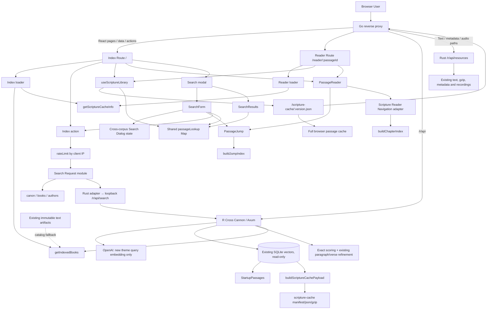
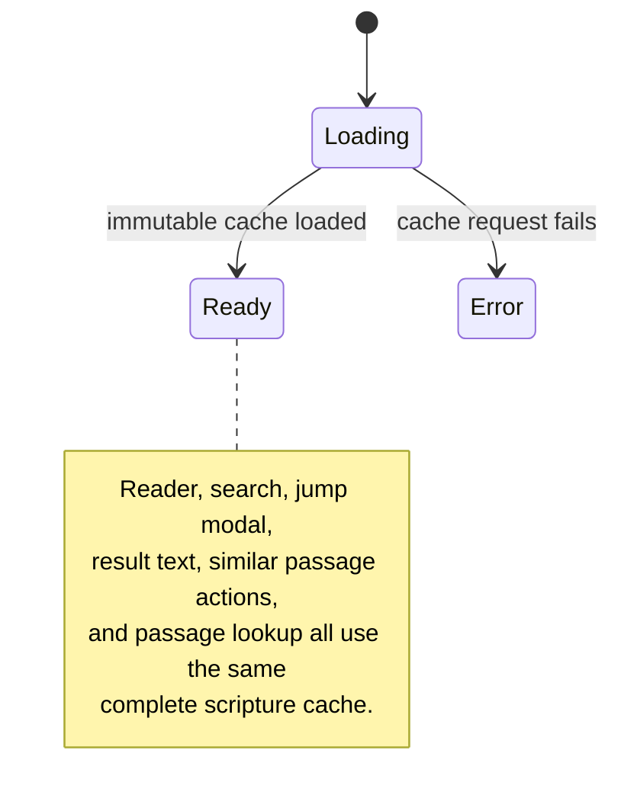
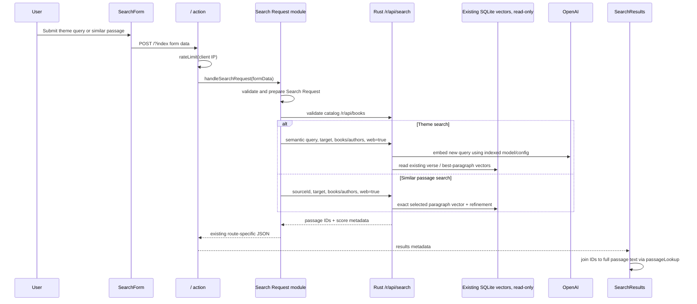
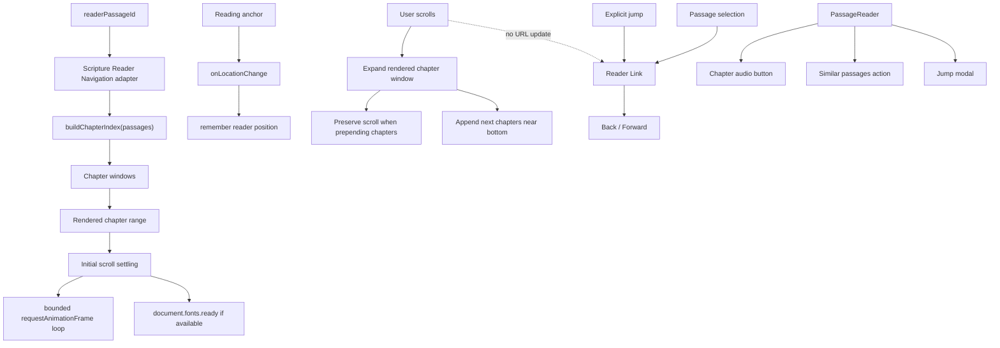

# Cross Cannon Architecture

This document maps the key runtime, search, reader, build, deploy, and
verification flows in Cross Cannon.

## Rendering

GitHub renders these Mermaid diagrams directly in the file preview.

Local options:

```bash
# Open the HTML renderer in a browser.
open docs/architecture.html

# Or render a single Mermaid file to SVG/PNG with Mermaid CLI.
npx -y @mermaid-js/mermaid-cli -i docs/runtime-architecture.mmd -o docs/runtime-architecture.svg
npx -y @mermaid-js/mermaid-cli -i docs/runtime-architecture.mmd -o docs/runtime-architecture.png

# Render every diagram and create docs/cross-cannon-architecture.png.
npm run render:architecture
```

VS Code also renders this file with an extension such as
`Markdown Preview Mermaid Support`.

## Runtime Architecture



## Scripture Readiness



## Search Flow



## Reader Flow



## Build, Deploy, And Verification

```mermaid
flowchart LR
  Dev[Local workspace] --> Verify[npm run verify]
  Verify --> Typecheck[tsc --noEmit]
  Verify --> RustChecks["Rust API tests + release build"]
  RustChecks --> LocalRust["Start loopback Rust API"]
  Verify --> Build[npm run build]
  Verify --> LocalServer[Start production server locally]
  Verify --> LocalSmoke["HEAD / + web POST results and Rust header"]
  Verify --> StopServer[Stop local web and Rust servers]

  Build --> RemixBuild["remix vite:build"]
  RemixBuild --> BuildDir["build/client + build/server"]

  Dev --> RustSnapshot["Publish compiler-input snapshot on dedicated build branch"]
  RustSnapshot --> RustCI["GitHub Actions queue; working checkout/index unchanged"]
  RustCI --> RustContainer["Hosted Linux Docker: pinned Rust image, linux/amd64"]
  RustContainer --> RustArtifact["Tested binary + systemd unit + checksums"]
  RustArtifact --> RustRelease["Commit-specific public release artifact"]
  RustRelease --> RustUpload["Download + verify + upload; shared deploy lock"]
  RustUpload --> RustReplace["Replace single managed Rust instance"]
  RustReplace --> RustHealth["Search/resource checks; rollback on failure"]

  Dev --> UpdateDbCache["npm run update-db:scripture-cache"]
  UpdateDbCache --> CacheScript["scripts/build-scripture-cache.ts"]
  CacheScript --> DB[("Local active DB")]
  CacheScript --> CacheArtifacts["scripture-cache/*.json + *.gz + manifest"]

  Dev --> Deploy["./deploy.sh"]
  Deploy --> Package["Zip build/public/scripts/cache/package files"]
  Package --> SCP[SCP to Ubuntu box]
  SCP --> Remote["/home/ubuntu/cross-cannon"]
  Remote --> PreserveStorage["Preserve remote storage/"]
  Remote --> NpmCi[npm ci --omit=dev --legacy-peer-deps]
  NpmCi --> Restart[systemctl restart cross-cannon]
  Restart --> RuntimeDbGuard["DB maintenance skipped unless CROSS_CANNON_UPDATE_DB=1"]

  Restart --> VerifyProd[npm run verify-prod]
  VerifyProd --> Systemd[SSH systemctl is-active + journalctl]
  VerifyProd --> LiveHead["HEAD https://www.crosscanon.com/"]
  VerifyProd --> LivePost[POST production search]
```



## Ownership Boundaries

```text
app/routes/
  Thin Remix route wiring: loaders, actions, page composition.

app/features/scripture/
  Browser scripture cache loading, shared readiness state, passageLookup.

app/features/search/
  Search UI, shared Search Dialog state, filters, result rendering, and
  server-side Search Request handling.

app/features/reader-navigation/
  Reader Links and the Scripture Reader Navigation adapter.

app/features/passage-reader/
  Reader layout, chapter windows, scroll preservation, passage actions.

app/features/passage-jump/
  Book/chapter/verse navigation modal.

app/lib/
  Database setup, scripture cache server metadata, embeddings, search engine,
  rate limiting, audio chapter helpers.

scripts/
  Index/build/download/deploy-adjacent operational scripts, shared Early
  Christian Work audio alignment, plus verification.
```

## Continuous Audio Playback

`app/features/audio/` owns the Scripture audio session,
chapter timestamps, original-recording fallback, and Media Session controls.
The Scripture reader adapts its chapter index to this player and does not
advance between files inside a combined book. Early Christian playback is
unchanged in the initial Bible-only rollout. Reader state follows audio time when
JavaScript is active again.

`scripts/build-continuous-audio.ts` preserves originals on the Mac mini and
creates a separate AAC file per book/Work from decoded source samples.
`public/continuous-audio.json` is a small timestamp manifest independent of the
scripture cache and database. `audio.continuous.$fileName.ts` forwards to Rust,
which streams content-addressed files from production storage with byte ranges.
Derived media is uploaded separately before the normal application release;
original recordings and source mappings remain available for rollback.


## Christian Classics

`app/features/work-reader/` configures the existing Work reader for Early
Christian Works and Christian Classics. The routes are thin adapters; chapter
rendering, navigation, selected Passage links, settings, Jump, search, audio
availability, and offline Work downloads share the existing implementation.
`/christian-classics` provides the browsing view and `/christian-classics/read`
opens the reader. Collections retain independent Reader Locations and favorites.

`scripts/import-christian-classics.py` verifies pinned raw sources and emits the
same book index, manifest, and immutable Chapter assets as Early Christian Works.
Commentaries additionally retain Scripture chapter/verse coverage. The Scripture
reader’s “View commentaries” action matches the selected book, chapter, and
overlapping verse ranges to show indexed notes. The native reader uses the same
coverage from its bundled catalog without an online search.

`npm run index:christian-classics` explicitly indexes these artifacts with the
shared indexer into `storage/christian-classics.db`. Rust loads this optional
third corpus read-only, preserving collection-specific author filters and vector
scoring. Existing Scripture and Early Christian databases are unchanged. A
normal deploy preserves production storage, so deploying this feature requires
separately provisioning the indexed Classics database before release.
